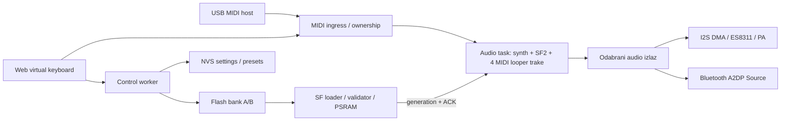

# Arhitektura porta

Ovo je arhitektura za P02–P07. P02 uključuje profil ploče, ES8311 izlaz i MIDI/synth
jezgru, a P03 USB MIDI host i MIDI ingress. P04 uključuje Web kontrolu, nativni
Wi-Fi i četiri looper trake. P05 uključuje A/B pohranu, startup preset, SF2
worker i renderer. P06 i P06B kvalificiraju izvedbu i opcionalni BT izlaz.

## Granice modula

- `board/`: target guard, pinovi, codec, PA i opcionalne kontrole. Bez C6 i SD polja.
- `audio_hal/`: postojeći 48 kHz/128-frame ugovor, DMA i telemetry; UI ne pristupa driveru.
- `midi/`, `synth/`, `soundfont/`: prenijeti zamrznutu logiku, bez promjene DSP algoritama
  dok se ne ustanovi S31 baseline. Looper je sample-timed MIDI sequencer, ne audio recorder.
- `usb_midi_host/`: jedan vlasnik submit/claim/release i session invalidation pri disconnectu.
- `bank_store/`: flash slotovi, header/CRC/SHA i recovery.
- `main/app_storage.c`: jedini runtime storage vlasnik je HTTP task. Čita i
  validira banku, priprema engine i eksplicitno sprema NVS preset.
- `audio_hal/audio_sampler.c`: RT vlasništvo banke i pet partova. Worker
  oslobađa prethodnu banku nakon lifecycle ACK-a.
- `app_wifi/`, `app_web/`: nativni Wi-Fi; radio lifecycle i Web HOLD release testirati ponovno.
- Display: zasebni opcionalni adapter; prvi build ne smije zahtijevati LCD niti tipku.

## Raspored i real-time pravila

Početna hipoteza: audio na core1, USB/Web/control na core0 kao u izvorniku. To se
provjerava na S31 uz nativni radio; nije dokaz da su interferencije iste kao na P4.
Audio ne radi malloc/free, log, flash/NVS/HTTP, filesystem niti neograničeni lock.
Mjeriti cijelu pripremu bloka (događaji + DSP + PCM), ne samo SF render funkciju.
DMA bufferi i ISR state u internoj prikladnoj memoriji; SF uzorci u PSRAM-u.

Flash operacije imaju poseban kontrolni protokol: zabrani nove note, provjeri prazne
aktivne glasove i zaustavljen transport, utišaj izlaz, koordinirano zaustavi audio/DMA,
izvrši operaciju, ponovno pokreni audio i tek tada oslobodi ingress. Kada je instrument
zauzet, početni API odbija zahtjev s jasnim statusom; ne uništava looper sadržaj.
To vrijedi i za NVS save i OTA, ne samo upload. Nema tvrdnje da običan mutex ili drugi
task čini flash write bezopasnim za PSRAM DSP. Detalji: [storage](STORAGE_AND_MEMORY.md).

## Uklanjanje recorder ovisnosti

Ukloniti recorder callback/tap iz audio putanje, status/telemetry polja, inicijalizaciju,
task, ring, HTTP rute, konzolne naredbe i Web polling. Ukloniti SD mount/list/test i
recordings direktorij. Ne uklanjati `looper_*`, looper REC/OVERDUB niti pripadajuće
MIDI testove zbog zajedničke riječi „record”. Ponovno generirati Web `.inc` iz izvora.

## Bluetooth zvučnik — P06B

Lokalni zvučnik je zadan. Opcionalni razvojni profil dodaje Web odjeljak
**Audio output** i Classic A2DP Source kroz Bluedroid. Zasebni Bluetooth task
vodi skeniranje, spajanje i pokretanje streama. Audio task predaje isti miks
u fiksni PCM red bez čekanja, a I2S tijekom Bluetooth reprodukcije daje ritam
tihim PCM blokovima. Izgubljena veza utišava izlaz dok korisnik ponovno ne
spoji zvučnik ili odabere lokalni izlaz.
[P06B postupak i granice](P06B_BLUETOOTH.md).

